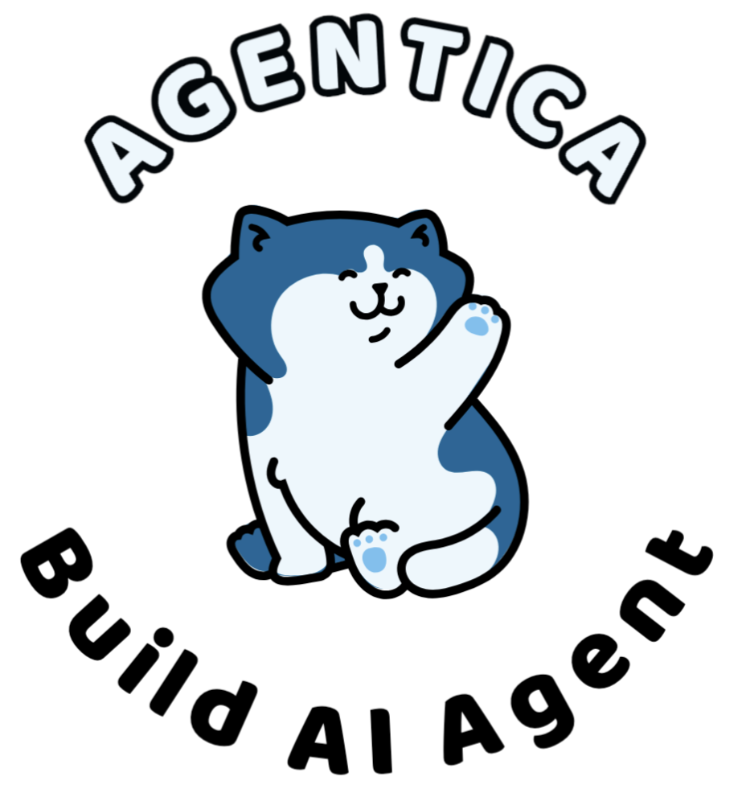
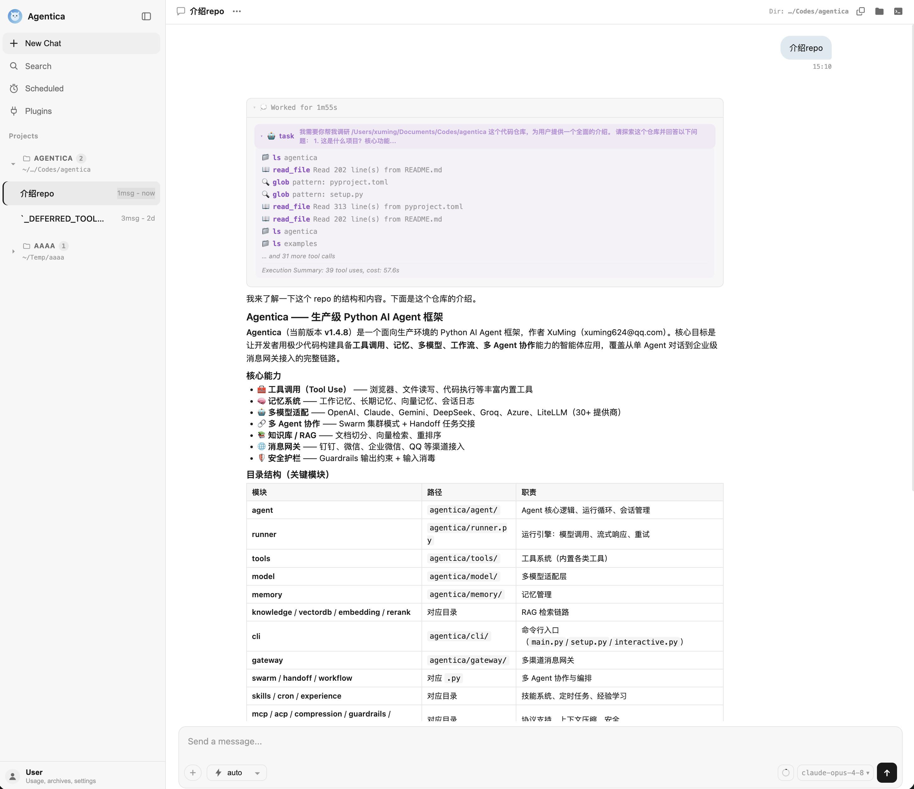
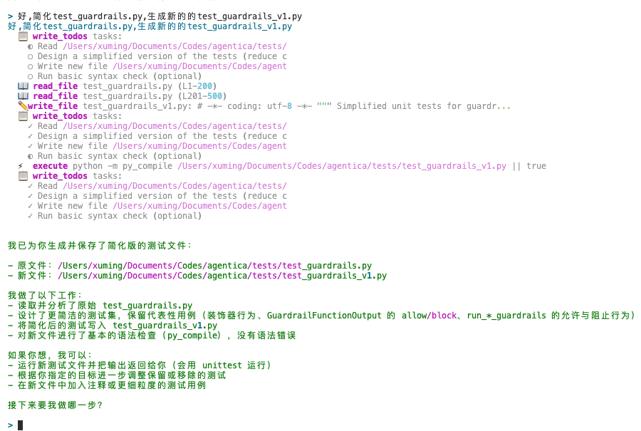
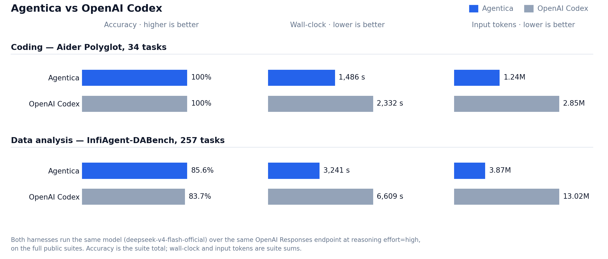

<p align="center">
  <a href="https://github.com/shibing624/agentica">
    
  </a>
</p>

<h1 align="center">Agentica</h1>

<p align="center"><b>跑在你自己电脑上的全能 AI 工作台。</b><br />桌面端、CLI 终端、本地网页、手机微信随时开干，记忆与技能越用越熟 —— 同时提供 Python & TypeScript SDK。</p>

<h3 align="center">
  <a href="https://github.com/shibing624/agentica/releases/latest">⬇️ 下载桌面版 Desktop App</a>
  &nbsp;·&nbsp;
  <a href="https://shibing624.github.io/agentica">📖 使用文档</a>
</h3>

<p align="center">macOS · Windows · Linux 开箱即用，数据与记忆留在你自己的电脑上</p>

<p align="center">
  <a href="https://badge.fury.io/py/agentica"></a>
  <a href="https://github.com/shibing624/agentica"></a>
  <a href="https://github.com/shibing624/agentica/blob/main/LICENSE"></a>
  <a href="#社区与支持"></a>
</p>

<p align="center">简体中文 | <a href="https://github.com/shibing624/agentica/blob/main/README_EN.md">English</a></p>

https://github.com/user-attachments/assets/39fb961e-3979-4629-a87d-81dce9196597

---

## 选择你的使用方式

同一套本地记忆、技能和会话记录，在哪一端打开都能接着聊。

| 产品 | 适合谁 | 立即开始 |
|---|---|---|
| **🖥️ Desktop App（桌面端）** | 想要独立窗口应用，零环境配置、打开即用 | [前往 Releases 下载安装包](https://github.com/shibing624/agentica/releases/latest)（[桌面端说明](https://shibing624.github.io/agentica/advanced/gateway)） |
| **⌨️ CLI 终端** | 在终端里写代码、查 Bug、开多个窗口并行干活 | [CLI 安装与终端指南](https://shibing624.github.io/agentica/getting-started/terminal) |
| **🌐 本地 Web & 手机 IM** | 浏览器多工作区 / 多账号管理，或用微信、飞书、企微、Telegram 远程指挥本机 | [Web 与微信/IM 接入指南](https://shibing624.github.io/agentica/advanced/gateway) |
| **🐍 Python SDK & 📦 npm SDK** | 把 Agent 嵌入你自己的 Python 服务或 Node / TypeScript 应用 | [Python 5 分钟上手](https://shibing624.github.io/agentica/getting-started/quickstart) · [TypeScript SDK (`@agentica-ai/sdk`)](https://shibing624.github.io/agentica/advanced/gateway) |

模型 API Key 配置、免费模型起步与 Docker 部署，请看 **[安装与配置文档](https://shibing624.github.io/agentica/getting-started/installation)**。

<p align="center">
  
</p>

<p align="center">
  
</p>

---

## 为什么选 Agentica

### 1. 🏆 同一个模型，更准、更快、更省钱

对 DeepSeek、智谱、通义千问、Kimi、豆包以及 OpenAI、Claude 等模型深度适配，会话中随时切换。和 OpenAI Codex 用同一个模型跑同一批公开题库：

<p align="center">
  
</p>

**编程题全对、数据分析题准确率更高——耗时少一半、输入 token 省三分之二。** 详见 [评测报告](https://shibing624.github.io/agentica/guides/benchmark)。

### 2. 🤝 多窗口组队，一个人指挥一支队伍

一个窗口不够用时，Agent 可以自己派生只读子任务查代码查资料，也可以把独立的大功能交给后台新进程去跑，或者让多个打开的终端窗口直接互通消息、分工配合。详见 [多智能体协作](https://shibing624.github.io/agentica/multi-agent/choosing)。

### 3. 🧬 越用越懂你和你的项目

你的习惯与项目背景会自动记进长期记忆；踩过的坑和跑通的流程能沉淀为可复用的技能（Skill）。下次遇到同类任务直接按老规矩办，不用每次从头交代。详见 [记忆系统](https://shibing624.github.io/agentica/concepts/memory) 与 [Skills](https://shibing624.github.io/agentica/advanced/skills)。

### 4. 🧠 长任务不掉链子，聊再久也不忘事

命令输出太长会自动存盘按需读取，窗口快满时自动清理旧输出并做好进度交接，完整历史随时可查回。不会聊到一半报超长错误，也不会把你最早交代的目标丢掉。详见 [上下文管理](https://shibing624.github.io/agentica/advanced/compression)。

### 5. 📱 人离开电脑，手机微信接着管

个人微信扫码即连（也支持飞书、企业微信、Telegram、QQ、钉钉、Slack），不需要公网 IP。出门在外可以直接在手机上查看电脑里哪几个任务还在跑、发话指挥它们，或者让助理帮你汇总进度。详见 [微信与 IM 指南](https://shibing624.github.io/agentica/advanced/gateway)。

---

## 和其它工具对比

| | Agentica | Claude Code | Codex CLI |
|---|---|---|---|
| **产品形态** | ✅ Desktop App + CLI + 本地 Web + 手机 IM | CLI / IDE | CLI |
| **模型选择** | ✅ 多厂商自由切换（国产 / 海外 / 本地 Ollama） | 仅 Claude | 仅 OpenAI |
| **多会话组队协作** | ✅ 子任务 + 后台进程 + 跨窗口通信 | ❌ | ❌ |
| **长期记忆与自进化技能** | ✅ 自动记忆 + 经验沉淀为 Skill | ❌ | ❌ |
| **SDK 二次开发** | ✅ Python SDK (`agentica`) + npm (`@agentica-ai/sdk`) | 部分（绑定 Claude） | ❌ |
| **开源协议** | ✅ Apache 2.0 | ❌ | ✅ |

---

## 文档与示例

- **完整文档站**：**https://shibing624.github.io/agentica**
- **快速入口**：[安装与配置](https://shibing624.github.io/agentica/getting-started/installation) · [桌面端与 Web / 微信](https://shibing624.github.io/agentica/advanced/gateway) · [CLI 终端](https://shibing624.github.io/agentica/getting-started/terminal) · [Python SDK 快速上手](https://shibing624.github.io/agentica/getting-started/quickstart)
- **代码示例库**：[examples/](https://github.com/shibing624/agentica/tree/main/examples)（基础用法、多智能体编排、RAG、MCP、工作流与完整行业应用）
- **开发者选读**：[架构设计与内部实现](https://shibing624.github.io/agentica/introduction/architecture)

---

## 🔥 News

- [2026/11/12] **v1.5.2**：Web / Desktop 后台任务与自动化任务、提问卡与实时思考，以及用 `agentica watch` 跟踪本机之外的长任务。详见 [Release-v1.5.2](https://github.com/shibing624/agentica/releases/tag/v1.5.2)
- [2026/11/04] **v1.5.1**：Web 与桌面端后端独立为 `agentica-gateway` 包并与 `agentica` 同版本发布；桌面端 macOS / Windows / Linux 安装包、PyPI 与 npm `@agentica-ai/sdk` 同步更新。详见 [Release-v1.5.1](https://github.com/shibing624/agentica/releases/tag/v1.5.1)
- [2026/10/22] **v1.5.0**：Langfuse 5 全链路追踪升级；长会话历史完整重放与跨模型切换保留工具记录；按模型实测 token 校准上下文压缩。详见 [Release-v1.5.0](https://github.com/shibing624/agentica/releases/tag/v1.5.0)
- [2026/10/15] **v1.4.17**：内置看图工具；网关空回复自动重试；目录结构收敛，公开导入保持兼容。详见 [Release-v1.4.17](https://github.com/shibing624/agentica/releases/tag/v1.4.17)
- [2026/09/15] **v1.4.16**：上下文满窗改为零成本换窗并保留全文检索；CLI 支持外部 Hooks。详见 [Release-v1.4.16](https://github.com/shibing624/agentica/releases/tag/v1.4.16)
- 更早版本记录见 [Releases](https://github.com/shibing624/agentica/releases) 与 [CHANGELOG.md](https://github.com/shibing624/agentica/blob/main/CHANGELOG.md)。

---

## 社区与支持

> 如果 Agentica 帮到了你，欢迎点个 ⭐ Star，让更多人看到！

- **问题反馈与建议** — [GitHub Issues](https://github.com/shibing624/agentica/issues)
- **微信交流群** — 添加微信号 `xuming624`，备注 `llm` 加入技术交流群


## 引用

如果您在研究中使用了 Agentica 的自进化与 skill 准入，请引用：

> Shang, L., Xu, M., Sun, Y., Xia, T., Hu, L., Xu, L., & Zheng, N. (2026). *When Self-Evolution Backfires: Pre-Commit Gating against Skill Contamination in LLM Agents*. arXiv:2608.05810. https://arxiv.org/abs/2608.05810

BibTeX：

```bibtex
@misc{shang2026selfevolution,
  title         = {When Self-Evolution Backfires: Pre-Commit Gating against Skill Contamination in LLM Agents},
  author        = {Shang, Linfang and Xu, Ming and Sun, Yiding and Xia, Tianle and Hu, Lingxiang and Xu, Lan and Zheng, Ning},
  year          = {2026},
  eprint        = {2608.05810},
  archivePrefix = {arXiv},
  primaryClass  = {cs.AI},
  url           = {https://arxiv.org/abs/2608.05810}
}
```

软件本身：

> Xu, M. (2026). Agentica: A Human-Centric Framework for Large Language Model Agent Workflows. GitHub. https://github.com/shibing624/agentica

```bibtex
@misc{xu2026agentica,
  author    = {Xu, Ming},
  title     = {Agentica: A Human-Centric Framework for Large Language Model Agent Workflows},
  year      = {2026},
  publisher = {GitHub},
  url       = {https://github.com/shibing624/agentica}
}
```

仓库根目录也提供了 [CITATION.cff](https://github.com/shibing624/agentica/blob/main/CITATION.cff)。

## 许可证

[Apache License 2.0](https://github.com/shibing624/agentica/blob/main/LICENSE)

## 贡献

欢迎贡献！请查看 [CONTRIBUTING.md](https://github.com/shibing624/agentica/blob/main/CONTRIBUTING.md)。

## 致谢

- [phidatahq/phidata](https://github.com/phidatahq/phidata)
- [openai/openai-agents-python](https://github.com/openai/openai-agents-python)
