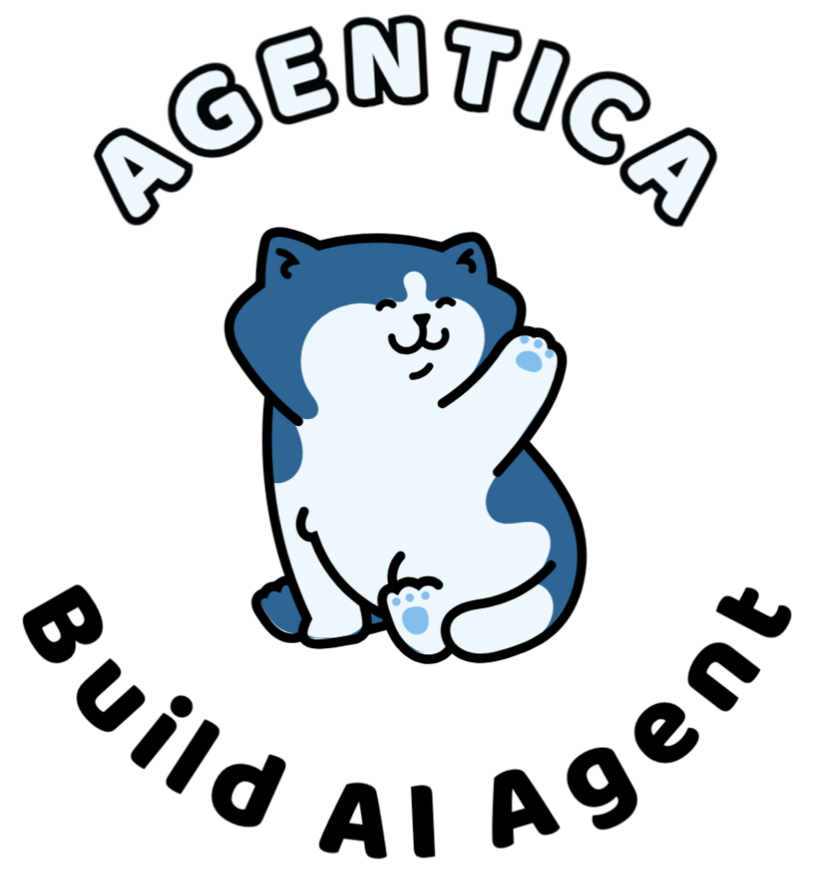
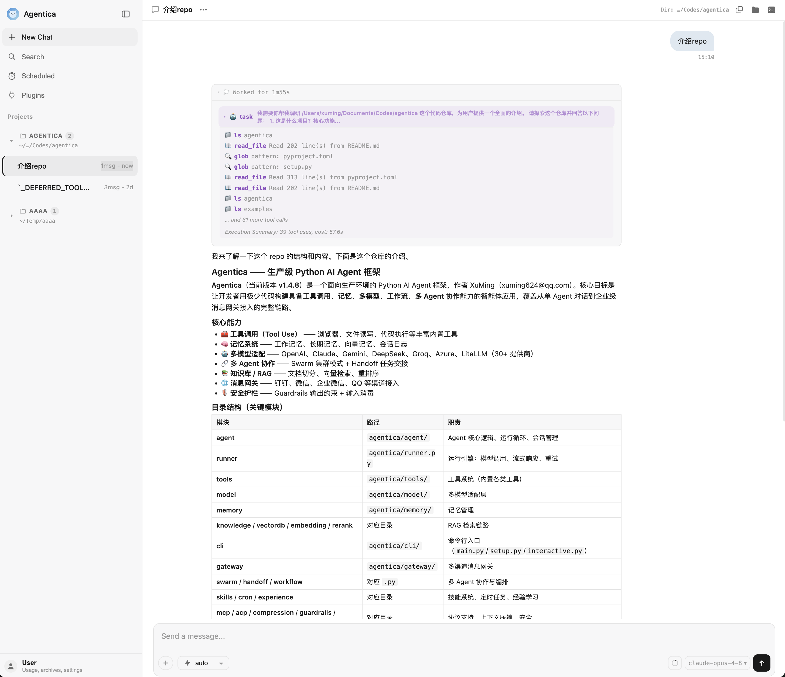
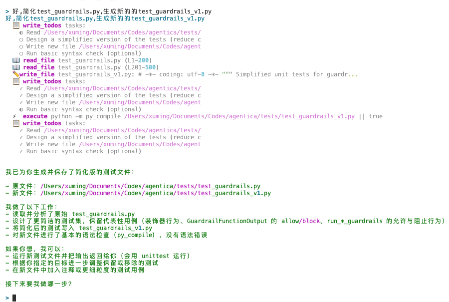
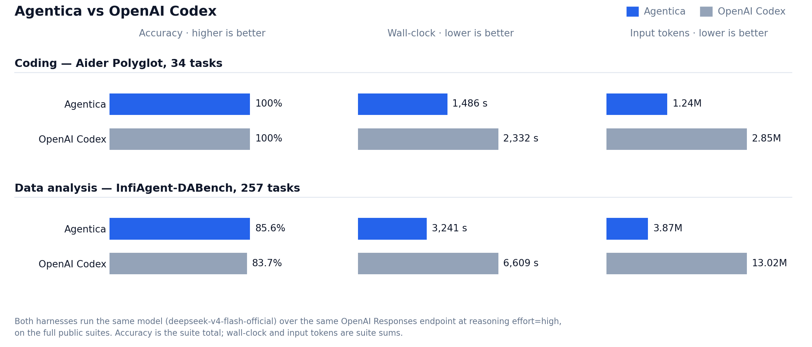

<p align="center">
  <a href="https://github.com/shibing624/agentica">
    
  </a>
</p>

<h1 align="center">Agentica</h1>

<p align="center"><b>Your all-in-one AI workspace running on your own machine.</b><br />Work from the Desktop App, CLI Terminal, Local Web, or Mobile IM — with memory and skills that get sharper the more you use them, plus Python & TypeScript SDKs.</p>

<h3 align="center">
  <a href="https://github.com/shibing624/agentica/releases/latest">⬇️ Download Desktop App</a>
  &nbsp;·&nbsp;
  <a href="https://shibing624.github.io/agentica">📖 Documentation</a>
</h3>

<p align="center">Ready to run on macOS · Windows · Linux — your data and memory stay on your machine</p>

<p align="center">
  <a href="https://badge.fury.io/py/agentica"></a>
  <a href="https://github.com/shibing624/agentica"></a>
  <a href="https://github.com/shibing624/agentica/blob/main/LICENSE"></a>
  <a href="#community--support"></a>
</p>

<p align="center"><a href="https://github.com/shibing624/agentica/blob/main/README.md">简体中文</a> | English</p>

https://github.com/user-attachments/assets/39fb961e-3979-4629-a87d-81dce9196597

---

## Pick How You Work

Every surface shares the same local memory, skills, and session history on your machine.

| Product | Best for | Get started |
|---|---|---|
| **🖥️ Desktop App** | Standalone native window, zero environment setup | [Download from Releases](https://github.com/shibing624/agentica/releases/latest) ([Desktop guide](https://shibing624.github.io/agentica/advanced/gateway)) |
| **⌨️ CLI Terminal** | Coding, debugging, and running parallel sessions in the terminal | [CLI installation & terminal guide](https://shibing624.github.io/agentica/getting-started/terminal) |
| **🌐 Local Web & Mobile IM** | Browser workspaces, multi-account setup, or controlling your machine from WeChat / Feishu / WeCom / Telegram | [Web & IM setup guide](https://shibing624.github.io/agentica/advanced/gateway) |
| **🐍 Python SDK & 📦 npm SDK** | Embedding agents in Python services or calling the gateway from Node / TypeScript | [Python Quickstart](https://shibing624.github.io/agentica/getting-started/quickstart) · [TypeScript SDK (`@agentica-ai/sdk`)](https://shibing624.github.io/agentica/advanced/gateway) |

For model API keys, free starter models, and Docker self-hosting, see the **[Installation & Configuration Guide](https://shibing624.github.io/agentica/getting-started/installation)**.

<p align="center">
  
</p>

<p align="center">
  
</p>

---

## Why Agentica

### 1. 🏆 Same model, higher accuracy, half the time

Deeply tuned for open and frontier models alike — DeepSeek, OpenAI, Claude, ZhipuAI, Qwen, Kimi, Volcengine Ark, and local Ollama — swappable mid-session. Head-to-head against OpenAI Codex on the same model and public benchmarks:

<p align="center">
  
</p>

**A clean sweep on coding and higher accuracy on data analysis — in roughly half the wall-clock time and a third of the input tokens.** See the [Benchmark Report](https://shibing624.github.io/agentica/guides/benchmark).

### 2. 🤝 Coordinate multiple agents like a team

An agent can spin up fast read-only subagents to search code, hand off large jobs to background worker processes, or message other open terminal sessions directly — with nothing extra to deploy. See [Multi-Agent Collaboration](https://shibing624.github.io/agentica/multi-agent/choosing).

### 3. 🧬 Learns your habits and your codebase

Your preferences and project facts are saved to long-term memory, and proven workflows are compiled into reusable `SKILL.md` playbooks so you never have to repeat the same instructions. See [Memory](https://shibing624.github.io/agentica/concepts/memory) and [Skills](https://shibing624.github.io/agentica/advanced/skills).

### 4. 🧠 Built for long sessions that never lose the plot

Large outputs automatically spill to disk, old tool outputs are cleaned up when the window gets tight, and full windows roll over cleanly with handover notes while keeping the entire history searchable. See [Context Management](https://shibing624.github.io/agentica/advanced/compression).

### 5. 📱 Step away from your desk and keep directing from your phone

Link WeChat (scan a QR code), Feishu, WeCom, Telegram, QQ, DingTalk, or Slack with no public IP required. Check running terminal sessions, send instructions into any window, or ask your assistant to coordinate them for you. See the [Gateway & IM Guide](https://shibing624.github.io/agentica/advanced/gateway).

---

## How It Compares

| | Agentica | Claude Code | Codex CLI |
|---|---|---|---|
| **Surfaces** | ✅ Desktop App + CLI + Local Web + Mobile IM | CLI / IDE | CLI |
| **Models** | ✅ Any provider, switch anytime (cloud or local Ollama) | Claude only | OpenAI only |
| **Multi-session teamwork** | ✅ Subagents + background workers + cross-terminal messaging | ❌ | ❌ |
| **Long-term memory & evolving skills** | ✅ Auto memory + experience compiled into Skills | ❌ | ❌ |
| **SDKs for developers** | ✅ Python SDK (`agentica`) + npm (`@agentica-ai/sdk`) | Partial (Claude-only) | ❌ |
| **Open source** | ✅ Apache 2.0 | ❌ | ✅ |

---

## Documentation & Examples

- **Documentation site**: **https://shibing624.github.io/agentica**
- **Popular guides**: [Installation & Configuration](https://shibing624.github.io/agentica/getting-started/installation) · [Desktop, Web & IM](https://shibing624.github.io/agentica/advanced/gateway) · [CLI Terminal](https://shibing624.github.io/agentica/getting-started/terminal) · [Python SDK Quickstart](https://shibing624.github.io/agentica/getting-started/quickstart)
- **Runnable examples**: [examples/](https://github.com/shibing624/agentica/tree/main/examples) (basics, multi-agent patterns, RAG, MCP, workflows, and end-to-end applications)
- **Developer internals**: [Architecture & Execution Engine](https://shibing624.github.io/agentica/introduction/architecture)

---

## 🔥 News

- [2026/11/04] **v1.5.1**: Standalone `agentica-gateway` package released in lockstep with `agentica`; updated macOS / Windows / Linux Desktop installers, PyPI packages, and npm `@agentica-ai/sdk`. See [Release-v1.5.1](https://github.com/shibing624/agentica/releases/tag/v1.5.1)
- [2026/10/22] **v1.5.0**: Langfuse 5 request tracing, full-window history replay, cross-provider fallback with tool history intact, and provider-calibrated context compression. See [Release-v1.5.0](https://github.com/shibing624/agentica/releases/tag/v1.5.0)
- [2026/10/15] **v1.4.17**: Built-in image analysis, automatic retry on empty gateway replies, and cleaner internal package layout. See [Release-v1.4.17](https://github.com/shibing624/agentica/releases/tag/v1.4.17)
- [2026/09/15] **v1.4.16**: Zero-cost context window rollover with full-session search and optional CLI hooks. See [Release-v1.4.16](https://github.com/shibing624/agentica/releases/tag/v1.4.16)
- Earlier releases: [GitHub Releases](https://github.com/shibing624/agentica/releases) · [CHANGELOG.md](https://github.com/shibing624/agentica/blob/main/CHANGELOG.md)

---

## Community & Support

> If Agentica helps you, please give it a ⭐ Star so more people can find it!

- **Issues & Feature Requests** — [GitHub Issues](https://github.com/shibing624/agentica/issues)
- **WeChat Group** — Add `xuming624` on WeChat with note `llm` to join the community group


## Citation

If you use Agentica's self-evolution or skill admission in research, please cite:

> Shang, L., Xu, M., Sun, Y., Xia, T., Hu, L., Xu, L., & Zheng, N. (2026). *When Self-Evolution Backfires: Pre-Commit Gating against Skill Contamination in LLM Agents*. arXiv:2608.05810. https://arxiv.org/abs/2608.05810

BibTeX:

```bibtex
@misc{shang2026selfevolution,
  title         = {When Self-Evolution Backfires: Pre-Commit Gating against Skill Contamination in LLM Agents},
  author        = {Shang, Linfang and Xu, Ming and Sun, Yiding and Xia, Tianle and Hu, Lingxiang and Xu, Lan and Zheng, Ning},
  year          = {2026},
  eprint        = {2608.05810},
  archivePrefix = {arXiv},
  primaryClass  = {cs.AI},
  url           = {https://arxiv.org/abs/2608.05810}
}
```

The software itself:

> Xu, M. (2026). Agentica: A Human-Centric Framework for Large Language Model Agent Workflows. GitHub. https://github.com/shibing624/agentica

```bibtex
@misc{xu2026agentica,
  author    = {Xu, Ming},
  title     = {Agentica: A Human-Centric Framework for Large Language Model Agent Workflows},
  year      = {2026},
  publisher = {GitHub},
  url       = {https://github.com/shibing624/agentica}
}
```

A [CITATION.cff](https://github.com/shibing624/agentica/blob/main/CITATION.cff) is also available in the repo root.

## License

[Apache License 2.0](https://github.com/shibing624/agentica/blob/main/LICENSE)

## Contributing

Contributions welcome! See [CONTRIBUTING.md](https://github.com/shibing624/agentica/blob/main/CONTRIBUTING.md).

## Acknowledgements

- [phidatahq/phidata](https://github.com/phidatahq/phidata)
- [openai/openai-agents-python](https://github.com/openai/openai-agents-python)
