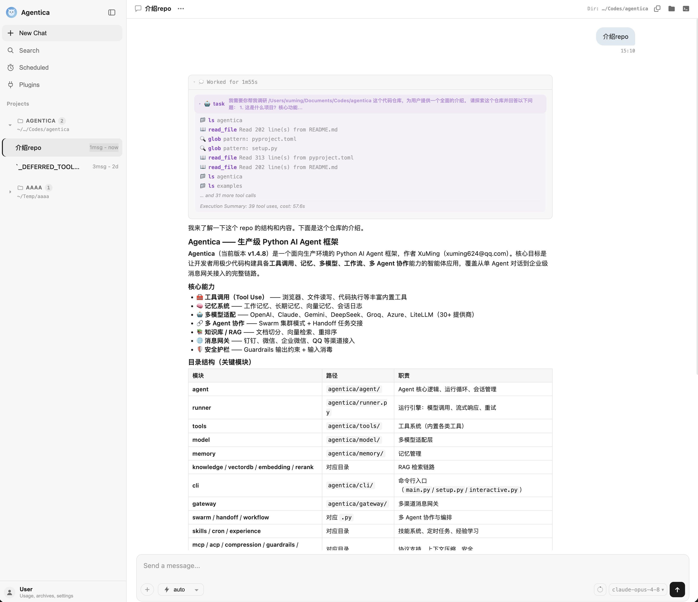
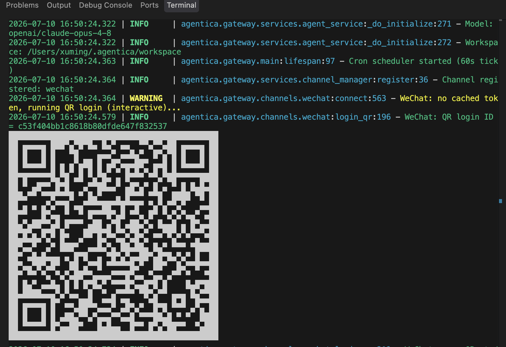
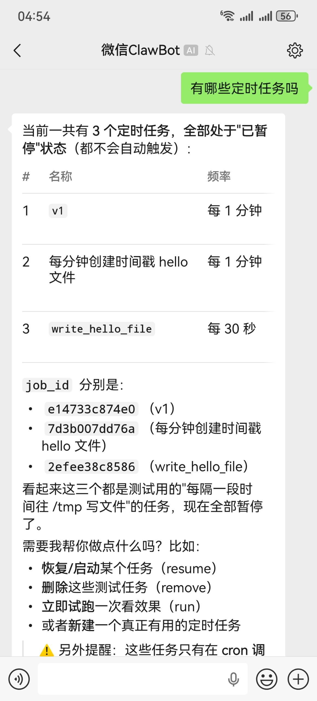

# Web、桌面端与微信/IM (`agentica-gateway`)

`agentica-gateway` 把你的本地 Agent 变成一个常驻服务：既提供**本地网页（Web UI）**和**桌面应用（Desktop App）**，又能同时接入**个人微信、飞书、企业微信、Telegram、QQ、钉钉、Discord、Slack**，让你在手机上直接对话，或者遥控电脑上正在跑的 CLI 终端会话。



---

## 一、安装与启动

### 1. 安装

如果你还没装过 Agentica，或者之前只装了 CLI，运行以下命令安装带 Web/IM 能力的完整版：

```bash
uv tool install --force "agentica[gateway]"
```

如果需要接入个人微信、企微、Telegram 等 IM 渠道，把渠道名一起写进引号里即可：

```bash
uv tool install --force "agentica[gateway,wechat]"                 # 个人微信（扫码即用）
uv tool install --force "agentica[gateway,wechat,wecom,telegram]"  # 同时安装多个渠道依赖
```

> 飞书（`feishu`）已默认包含在 `[gateway]` 中，无需额外追加。

### 2. 启动本地 Web 服务

在你的项目目录下直接运行：

```bash
agentica-gateway
```

默认监听 `http://127.0.0.1:8881`。终端启动日志会打印出：
- 首次免密打开的地址（`http://127.0.0.1:8881/chat?token=...`）
- 或者初始管理员账号 `default` 的随机登录密码（用于 `/login` 页面登录）

常用启动参数：

```bash
agentica-gateway --set-password      # 设置或修改网页登录密码
agentica-gateway --host 0.0.0.0      # 允许局域网其他设备访问（必须先设置密码）
agentica-gateway --port 8890         # 指定监听端口
```

### 3. 桌面应用（Desktop App）

直接下载对应系统的安装包（每个 [GitHub Release](https://github.com/shibing624/agentica/releases/latest) 页面同样附带）：

| 系统 | 安装包下载 |
|---|---|
| **macOS** 11+ | [Apple Silicon (arm64)](https://github.com/shibing624/agentica/releases/latest/download/agentica-desktop-darwin-arm64.dmg) · [Intel (x64)](https://github.com/shibing624/agentica/releases/latest/download/agentica-desktop-darwin-x64.dmg) |
| **Windows** 10+ | [x64 安装包 (.exe)](https://github.com/shibing624/agentica/releases/latest/download/agentica-desktop-win32-x64.exe) |
| **Linux** x64 | [AppImage](https://github.com/shibing624/agentica/releases/latest/download/Agentica-x86_64.AppImage) · [deb](https://github.com/shibing624/agentica/releases/latest/download/agentica-desktop-linux-amd64.deb) |

桌面版与 CLI、Web 共用同一个 `~/.agentica` 配置与历史记录。安装包自带 Python 3.12 和同版本的 `agentica` + `agentica-gateway[feishu]`，不依赖本机 Python、Node、uv，首次打开也不需要联网。

安装包当前**未签名**，首次启动若被系统拦截，按对应系统处理一次即可：

- **macOS 提示「已损坏，无法打开」**：把 `Agentica.app` 拖进「应用程序」后，在终端执行一次 `sudo xattr -rd com.apple.quarantine /Applications/Agentica.app`。
- **Windows 提示「Windows 已保护你的电脑」**：点「更多信息」→「仍要运行」。
- **Linux 双击 AppImage 无反应**：先赋执行权限 `chmod +x Agentica-x86_64.AppImage`。

几点说明（开发者与进阶用户）：

- **优先级**：`AGENTICA_GATEWAY_BIN` → 安装包内置运行环境 → 本机 `agentica-gateway`（仅 `npm start` 或不带运行环境的构建）。
- **终端命令**：菜单 `Help › Install 'agentica' Command in Terminal…` 生成调用内置 Python 的 `agentica` 命令（macOS 优先 `/usr/local/bin`，否则 `~/.local/bin`；Windows 写用户 PATH），不会覆盖不是它创建的同名文件。
- **自动更新**：基于 `electron-updater` 读取 GitHub Release。macOS 只接受已签名应用的更新，未签名构建会跳过检查，升级请重新下载安装包；`AGENTICA_DESKTOP_NO_UPDATE=1` 可全局关闭。
- **签名**：在仓库 secrets 配置 `CSC_LINK`、`CSC_KEY_PASSWORD`、`APPLE_ID`、`APPLE_APP_SPECIFIC_PASSWORD`、`APPLE_TEAM_ID`（macOS 签名 + 公证）和 `WIN_CSC_LINK`、`WIN_CSC_KEY_PASSWORD`（Windows）即可，不配则产出未签名安装包。
- **源码运行**：`cd desktop && npm install && npm start`（Node 22+），详见 [`desktop/README.md`](https://github.com/shibing624/agentica/blob/main/desktop/README.md)。

#### 工作区

侧栏按**工作区**（本机一个文件夹）归组对话：

- **添加**：标题行的文件夹图标，选择已存在的目录；不会替你创建目录。添加后立刻新建一个对话，空工作区也会显示。
- **重命名 / 删除**：工作区行的 `⋯` 菜单（双击名称也可重命名）。重命名只改显示名；删除会移除该工作区下的对话，有运行中对话时拒绝，磁盘文件夹不动。
- **存储**：账号偏好 `~/.agentica/gateway/prefs/<账号>.json` 的 `workspaces`（`[{dir, name?}]`），经 `GET/PUT /api/prefs` 读写。
- **调宽**：拖拽侧栏右边缘（220–480px），双击恢复 280px。

#### 会话侧栏

- 侧栏默认只列 **gateway 会话**（Web、桌面端、IM）。设置 › 常规「显示 CLI 会话」打开后才加入 CLI 会话；SDK 脚本和没有记录来源的旧日志不进这个列表。正在运行的会话始终列出。接口是 `GET /api/sessions?scope=recent|all&recent_days=30`，默认 `recent`。
- `recent` 里 CLI 会话只保留最近 `recent_days` 天（默认 30）；gateway 会话和已归档会话不受这个天窗口限制。`all` 去掉天窗口，仍然不含 SDK 和无来源的旧日志。
- 来源写在 `<session_id>.meta.json` 的 `source`（`gateway` / `cli`）。没有该字段时：sidecar 里有 CLI 偏好的算 CLI，有 `last_read_at` 的算网页会话，其余不列出。
- 每个项目分组默认显示 5 条，当前会话和运行中的会话不会被折叠；搜索同时匹配标题、项目名和首条消息。
- 实测 5000 个会话：默认请求约 0.4 秒、12KB（原来约 5.5 秒、1.9MB）。

### 4. Docker 部署（可选）

镜像内已编译好 Web UI，运行时不需要 Node。数据保存在 named volume，当前目录挂载到容器 `/workspace`：

```bash
cp .env.docker.example .env   # 填入 OPENAI_API_KEY 等模型密钥
docker compose up -d --build
```

启动后打开 `http://127.0.0.1:8881/chat`。

---

## 二、多账号与权限控制

### 1. 多账号隔离

Gateway 支持多用户登录：
- 管理员（`default`）登录后，点击网页右侧 **「用户管理」**（`/users`）即可新增普通账号、重置密码或删除账号。
- **每个账号拥有自己独立的会话列表、记忆（`MEMORY.md` / `AGENTS.md`）和定时任务**，互相不可见。

### 2. 工具审批档位（`ask` / `auto` / `allow-all`）

在网页右上角或设置中可以随时切换工具权限档位（默认 `auto`）：

| 档位 | 自动放行的操作 | 会弹出审批卡等你的操作 |
|---|---|---|
| **`ask`** | 读取文件、只读命令、搜索记忆、子任务 | **修改文件**、**会改动状态的命令**、联网搜索/抓取、高危命令 |
| **`auto`（默认）** | 读取文件、**当前工作区内的文件修改**、普通命令、联网搜索 | **工作区外或敏感路径的文件写入**、高危命令 |
| **`allow-all`** | 全部自动放行 | 无 |

当弹出审批卡时，你可以选择：
- **允许一次 / 拒绝一次**：仅对当前这次调用生效。
- **允许同类 / 拒绝同类**：记住这类命令前缀（如 `pytest`、`git status`），当前项目内后续遇到同类命令自动放行或直接拒绝。

---

## 三、用手机遥控电脑上的项目与 CLI 会话

只要本机跑着 `agentica-gateway` 并连上了任意一个 IM 渠道（如个人微信、企微、飞书、Telegram），每个 IM 会话就会作为一个**会话级遥控器**（`ImBotController`），直接绑定到本机的一个项目目录（`work_dir`）和一个会话（`session_id`），与 Mac 终端里的 `agentica` CLI 共用同一份 `SessionLog`（`~/.agentica/projects/.../<session_id>.jsonl`）：

| 你在微信/IM 里发送 | 效果 |
|---|---|
| **`/menu`（或 `菜单` / `0`）** | 查看当前绑定的项目目录、会话名称、终端在线状态，并弹出数字快捷菜单 |
| **`/resume`（或 `恢复`）** | 列出当前项目的历史会话与本机正在运行的 CLI 终端会话（带 `🟢终端` 标记），**回复数字 `1..N` 即可直接挂载**（回复 `0` 翻下一页） |
| **`/new [任务]`（或 `新建`）** | 在当前项目目录新建一个会话（可附带首条任务直接开跑） |
| **`/switch`（或 `切换`）** | 列出本机活跃的项目工作区目录，回复数字 `1..N` 切换项目 |
| **`/model`（或 `切换模型`）** | 列出配置的模型 Profile，回复数字切换当前会话模型 |
| **`/status`（或 `状态`）** | 查看当前绑定会话、模型、日志体积与运行状态 |
| **`/cancel`（或 `取消` / `停止`）** | 立即中止当前会话正在运行的任务（无论是在终端里跑还是在网关后台跑） |
| **`/verbose` / `/concise`** | 切换详细/简洁汇报模式 |
| **直接发任意文字** | 向当前绑定的会话提交一轮任务（不再需要任何 `@` 前缀）：<br>• 若该会话此刻正被某个打开的 CLI 终端持有，直接通过本地 `AttachServer` 注入该终端实时滚动执行，跑完由 Harness 自动把该轮最终回答推回手机（无需模型调 `send_message`）；<br>• 若终端未开，由网关后台在同一份 `SessionLog` 上执行，第二天在电脑终端 `agentica --resume` 无缝接力。 |

### 免登录签名卡片页（`/c/<token>`）与产物文件自动回传

- **审批与追问双通道竞速**：当任务触发工具审批（`needs.approval`）或追问（`ask_user_question`）时，IM 会收到编号选项以及一个自包含 HMAC 签名的短链 `/c/<token>`。你可以直接在微信里点开链接（零 JS、自适应深浅色、免登录大按钮表单，支持一键点选推荐项或输入自定义回答），也可以直接在微信里回复数字 `1..N` 或 `y`/`n`，哪边先操作哪边生效。
- **产物文件自动推送**：回复中包含生成的图表、PDF、表格等非源码产物文件链接（如 ``、`[报告](report.pdf)`）时，会自动通过当前 IM 渠道推送到手机。

---

## 四、接入个人微信与各 IM 平台

所有 IM 渠道均采用**长轮询或 WebSocket 长连接**，**不需要公网 IP、不需要域名、也不需要配置公网 Webhook**，在家里或公司内网电脑上直接启动即可连通。

### 1. 个人微信（扫码即用，最推荐）

无需注册任何开放平台应用：

1. 安装微信依赖并启动网关：
   ```bash
   uv tool install --force "agentica[gateway,wechat]"
   agentica-gateway
   ```
2. 打开浏览器进入 **设置 › 个人助理**（`/assistant`），找到「个人微信」点击 **「配置」**。
3. 用手机微信扫描页面弹出的二维码即可完成绑定（登录凭证保存在 `~/.agentica/cache/wxbot_token.json`，下次启动免扫码）。

<div style="display: flex; gap: 16px; align-items: flex-start;">
  
  
</div>

> **发送语音与视频**：如果主模型本身不支持直接听语音/看视频，可以在 `~/.agentica/config.yaml` 的 `settings.media_model` 里配一个 Gemini 模型用于自动转写和描述。

### 2. 其他 IM 渠道配置一览

在 `~/.agentica/.env`（或启动环境变量）中填入对应平台的凭证即可自动启用：

| 渠道 | 安装依赖 (`uv tool install --force ...`) | 必填环境变量 | 限制可访问用户的白名单变量（可选，留空为不限） |
|---|---|---|---|
| **飞书 (Lark)** | `"agentica[gateway]"`（已内置） | `FEISHU_APP_ID`<br>`FEISHU_APP_SECRET` | `FEISHU_ALLOWED_USERS`<br>`FEISHU_ALLOWED_GROUPS` |
| **企业微信 (WeCom)** | `"agentica[gateway,wecom]"` | `WECOM_BOT_ID`<br>`WECOM_SECRET` | `WECOM_ALLOWED_USERS` |
| **Telegram** | `"agentica[gateway,telegram]"` | `TELEGRAM_BOT_TOKEN` | `TELEGRAM_ALLOWED_USERS` |
| **QQ 机器人** | `"agentica[gateway,qq]"` | `QQ_APP_ID`<br>`QQ_APP_SECRET` | `QQ_ALLOWED_USERS` |
| **钉钉 (DingTalk)** | `"agentica[gateway,dingtalk]"` | `DINGTALK_CLIENT_ID`<br>`DINGTALK_CLIENT_SECRET` | `DINGTALK_ALLOWED_USERS` |

不用 uv、直接装网关包时，同名 extra 写在 `agentica-gateway` 上：`pip install "agentica-gateway[feishu,wecom]"`，`[all]` 是全部渠道。注意单装 `agentica-gateway` 不带飞书 SDK，`agentica[gateway]` 才默认带。
| **Discord** | `"agentica[gateway,discord]"` | `DISCORD_BOT_TOKEN` | `DISCORD_ALLOWED_USERS`<br>`DISCORD_ALLOWED_GUILDS` |
| **Slack** | `"agentica[gateway,slack]"` | `SLACK_BOT_TOKEN` (`xoxb-...`)<br>`SLACK_APP_TOKEN` (`xapp-...`) | `SLACK_ALLOWED_USERS`<br>`SLACK_ALLOWED_CHANNELS` |

各平台创建机器人的简要入口：
- **飞书**：[飞书开放平台](https://open.feishu.cn) → 创建企业自建应用 → 开启机器人能力与「接收消息」权限 → 事件订阅选择**使用长连接接收事件**。
- **企业微信**：企业微信管理后台 → 安全与管理 / 智能机器人 → 创建 AI Bot → 获取 `bot_id` 与 `secret`。
- **Telegram**：私聊 [@BotFather](https://t.me/BotFather) 发送 `/newbot` 拿 token。
- **QQ**：[QQ 开放平台](https://q.qq.com) 创建机器人获取 AppID 与 AppSecret。
- **钉钉**：[钉钉开放平台](https://open.dingtalk.com) 创建企业内部应用 → 开启机器人能力并选用 Stream 模式。

---

## 五、通过代码调用 Gateway（TypeScript / HTTP API）

如果你有外部脚本或前端想调用正在运行的 `agentica-gateway`，可以直接使用官方 TypeScript SDK 或 HTTP 接口（网关启动后可访问 `http://127.0.0.1:8881/docs` 查看完整交互式 OpenAPI 文档）。

### TypeScript SDK (`@agentica-ai/sdk`)

```bash
npm install @agentica-ai/sdk
```

```ts
import { Agentica } from "@agentica-ai/sdk";

const agentica = new Agentica({
  baseURL: "http://127.0.0.1:8881",
  // 机器令牌可从 ~/.agentica/cache/gateway/runtime.json 读取，或通过环境变量 AGENTICA_GATEWAY_TOKEN 固定
  apiKey: process.env.AGENTICA_GATEWAY_TOKEN,
});

for await (const event of agentica.chat.stream({
  message: "帮我总结一下当前目录的 README",
  session_id: "demo-session",
})) {
  if (event.event === "content") {
    process.stdout.write(String(event.data));
  }
}
```

### 主动向 IM 渠道发送通知 (`/api/send`)

你可以在部署脚本或告警钩子里直接让 Gateway 往你的微信、飞书或 QQ 推消息：

```bash
TOKEN=$(python -c "import json,os;print(json.load(open(os.path.expanduser('~/.agentica/cache/gateway/runtime.json')))['token'])")

curl -X POST http://127.0.0.1:8881/api/send \
  -H "Authorization: Bearer $TOKEN" \
  -H "Content-Type: application/json" \
  -d '{
    "channel": "feishu",
    "channel_id": "ou_xxx",
    "message": "线上构建已完成 ✅"
  }'
```

---

## 下一步

- [CLI 终端指南](../getting-started/terminal.md) — 终端交互与斜杠命令
- [定时任务 (/cron)](../guides/cron_scheduler.md) — 让 Gateway 或 CLI 按计划定时执行任务
- [统一配置文件 (config.yaml)](../guides/config.md) — 配置主模型、副模型与全局开关
