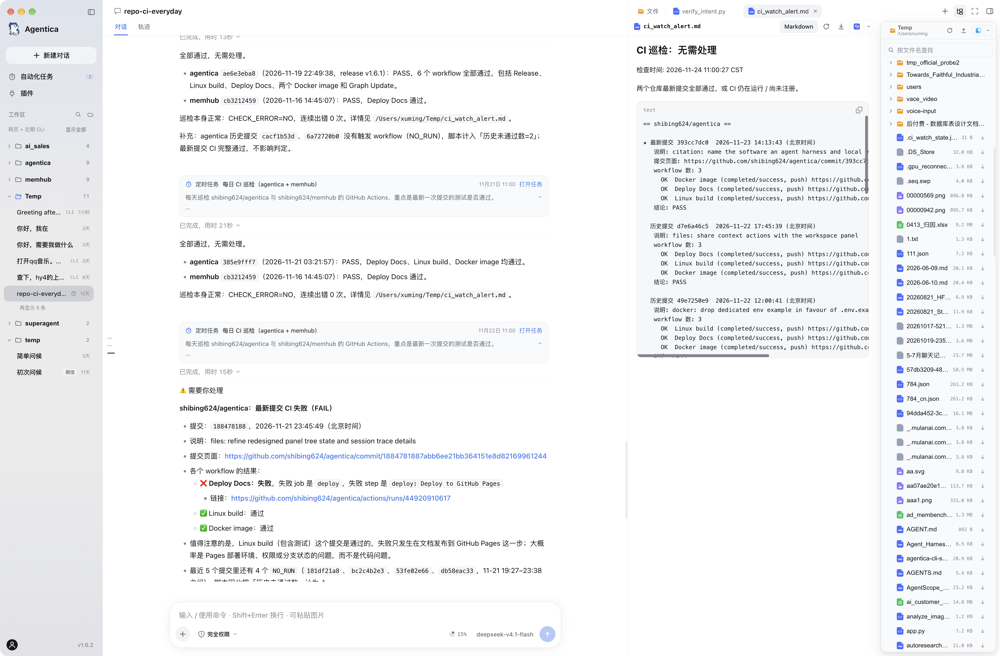

# Web 与桌面端

本地网页和桌面应用共用同一个 `agentica-gateway`：浏览器打开 `http://127.0.0.1:8881`，或者装一个独立窗口。两边和 CLI 读同一份 `~/.agentica`。

手机微信、飞书和其他 IM 在 [微信与 IM](im.md)。



---

## 安装并打开网页

还没装过，或者之前只装了 CLI：

```bash
uv tool install --force "agentica[gateway]"
```

在项目目录里启动：

```bash
agentica-gateway
```

默认监听 `http://127.0.0.1:8881`。启动日志会打印首次免密打开的地址（`http://127.0.0.1:8881/chat?token=...`），或者初始管理员账号 `default` 的随机登录密码（用于 `/login`）。

```bash
agentica-gateway --set-password      # 设置或修改网页登录密码
agentica-gateway --host 0.0.0.0      # 允许局域网其他设备访问（必须先设置密码）
agentica-gateway --port 8890         # 指定监听端口
```

飞书 SDK 已经包含在 `[gateway]` 里。个人微信和其他渠道的安装见 [微信与 IM](im.md)。

---

## 桌面应用

下载、按系统选择安装包，以及未签名时的一次放行，都在 **[下载桌面版](https://shibing624.github.io/agentica/desktop/)**。那一页打开时读取最新 Release，并按当前系统给出下载按钮。

桌面版与 CLI、Web 共用同一个 `~/.agentica`。安装包自带 Python 3.12 和同版本的 `agentica` + `agentica-gateway[feishu]`，不依赖本机 Python、Node、uv，首次打开也不需要联网。

开发者与进阶用户：

- **优先级**：`AGENTICA_GATEWAY_BIN` → 安装包内置运行环境 → 本机 `agentica-gateway`（仅 `npm start` 或不带运行环境的构建）。
- **终端命令**：菜单 `Help › Install 'agentica' Command in Terminal…` 生成调用内置 Python 的 `agentica` 命令（macOS 优先 `/usr/local/bin`，否则 `~/.local/bin`；Windows 写用户 PATH），不会覆盖不是它创建的同名文件。
- **自动更新**：基于 `electron-updater` 读取 GitHub Release。macOS 只接受已签名应用的更新，未签名构建会跳过检查，升级请重新下载安装包；`AGENTICA_DESKTOP_NO_UPDATE=1` 可全局关闭。
- **签名**：在仓库 secrets 配置 `CSC_LINK`、`CSC_KEY_PASSWORD`、`APPLE_ID`、`APPLE_APP_SPECIFIC_PASSWORD`、`APPLE_TEAM_ID`（macOS 签名 + 公证）和 `WIN_CSC_LINK`、`WIN_CSC_KEY_PASSWORD`（Windows）即可，不配则产出未签名安装包。
- **源码运行**：`cd desktop && npm install && npm start`（Node 22+），详见 [`desktop/README.md`](https://github.com/shibing624/agentica/blob/main/desktop/README.md)。

### 工作区

侧栏按**工作区**（本机一个文件夹）归组对话：

- **添加**：标题行的文件夹图标，选择已存在的目录；不会替你创建目录。添加后立刻新建一个对话，空工作区也会显示。
- **重命名 / 删除**：工作区行的 `⋯` 菜单（双击名称也可重命名）。重命名只改显示名；删除会移除该工作区下的对话，有运行中对话时拒绝，磁盘文件夹不动。
- **存储**：账号偏好 `~/.agentica/gateway/prefs/<账号>.json` 的 `workspaces`（`[{dir, name?}]`），经 `GET/PUT /api/prefs` 读写。
- **调宽**：拖拽侧栏右边缘（220–480px），双击恢复 280px。

### 会话侧栏

- 侧栏默认只列 **gateway 会话**（Web、桌面端、IM）。设置 › 常规「显示 CLI 会话」打开后才加入 CLI 会话；SDK 脚本和没有记录来源的旧日志不进这个列表。正在运行的会话始终列出。接口是 `GET /api/sessions?scope=recent|all&recent_days=30`，默认 `recent`；响应含 `hidden`（被折叠的较早/归档会话数），会话行由 `agentica.session.catalog` 产出。
- `recent` 由 `agentica.session.catalog.list_catalog` 统一折叠超过 `recent_days` 天的会话（计入 `hidden`），不再按来源豁免；在跑、有后台任务、置顶的不折叠，归档的只在归档视图。`all` 去掉天窗口，仍不含 SDK 和无来源的旧日志。
- 来源、可见性和标题统一由 `agentica.session.catalog` 读取 `<session_id>.meta.json`：识别 `gateway` / `cli` / 各 IM 渠道 / `cron`，无字段时按 CLI 偏好、`last_read_at`、旧 channel id 推断 `source` 与 `origin`，标题走 `SessionLog.display_title`。
- 每个项目分组默认显示 5 条，当前会话和运行中的会话不会被折叠；搜索同时匹配标题、项目名和首条消息。
- 实测 5000 个会话：默认请求约 0.4 秒、12KB（原来约 5.5 秒、1.9MB）。

---

## 多账号

管理员（`default`）登录后，点击网页右侧 **「用户管理」**（`/users`）即可新增普通账号、重置密码或删除账号。

每个账号有自己的会话列表、记忆（`MEMORY.md` / `AGENTS.md`）和定时任务，互相不可见。

---

## 工具审批

网页右上角或设置里切换档位，默认 `auto`：

| 档位 | 自动放行 | 会弹出审批卡 |
|---|---|---|
| **`read-only`** | 读取文件、只读命令、搜索记忆、子任务、联网搜索/抓取 | **修改文件**、**会改动状态的命令**、高危命令 |
| **`auto`（默认）** | 读取文件、**当前工作区内的文件修改**（临时目录也算）、普通命令、联网搜索、内置工具 | **工作区外或敏感路径的文件写入**、会离开沙箱的命令、高危命令。这些调用会先由模型审查：放行就直接执行，拒绝或审查失败才弹卡。审查默认用副模型（`auxiliary_model`），没配则用主模型；可在 profile 里用 `auto_review_model` 指定别的 LLM |
| **`allow-all`** | 全部自动放行 | 无 |

联网工具（`web_search` / `fetch_url`）在任何档位都不弹审批卡。旧的 `ask` 档已改名为 `read-only`。

审批卡上可以选：

- **允许一次 / 拒绝一次**：只对这一次调用生效。
- **允许同类 / 拒绝同类**：记住这类命令前缀（如 `pytest`、`git status`），当前项目里后续同类命令自动放行或直接拒绝。

手机上处理同一张卡的办法见 [微信与 IM](im.md)。

---

## Docker（可选）

镜像内已编译好 Web UI，运行时不需要 Node。数据保存在 named volume，当前目录挂载到容器 `/workspace`：

```bash
cp .env.example .env   # 填入 OPENAI_API_KEY 等模型密钥
docker compose up -d --build
```

启动后打开 `http://127.0.0.1:8881/chat`。

---

## 用代码调用

网关跑起来之后，外部脚本可以走 TypeScript SDK 或 HTTP。交互式接口在 `http://127.0.0.1:8881/docs`。

```bash
npm install @agentica-ai/sdk
```

```ts
import { Agentica } from "@agentica-ai/sdk";

const agentica = new Agentica({
  baseURL: "http://127.0.0.1:8881",
  // 机器令牌在 ~/.agentica/cache/gateway/runtime.json，或用环境变量 AGENTICA_GATEWAY_TOKEN 固定
  apiKey: process.env.AGENTICA_GATEWAY_TOKEN,
});

for await (const event of agentica.chat.stream({
  message: "帮我总结一下当前目录的 README",
  session_id: "demo-session",
})) {
  if (event.event === "content") {
    process.stdout.write(String(event.data));
  }
}
```

往微信或飞书推一条消息用 [`/api/send`](im.md#主动推送)。

---

## 下一步

- [微信与 IM](im.md) — 扫码绑定个人微信，在手机上遥控本机会话
- [下载桌面版](https://shibing624.github.io/agentica/desktop/) — 按当前系统下载安装包
- [CLI 终端指南](../getting-started/terminal.md) — 终端交互与斜杠命令
- [定时任务 (/cron)](../guides/cron_scheduler.md) — 让 Gateway 或 CLI 按计划执行任务
- [统一配置文件 (config.yaml)](../guides/config.md) — 配置主模型、副模型与全局开关
