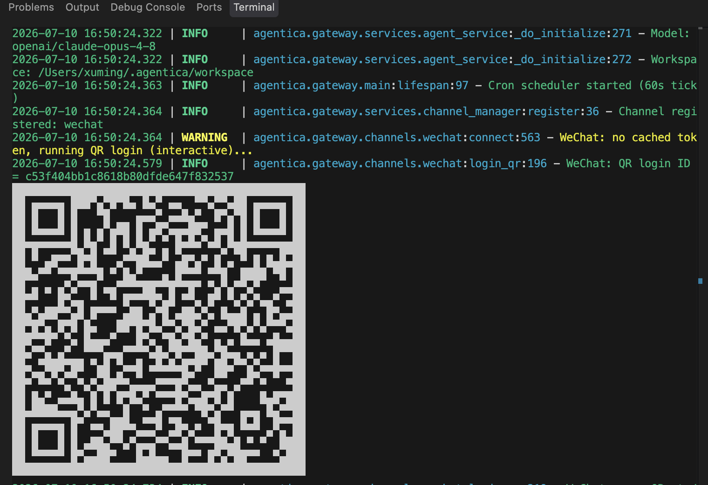
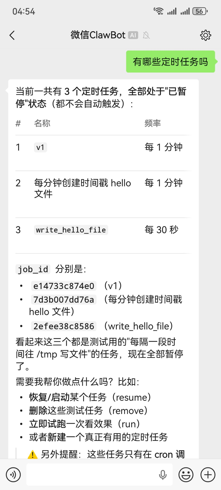

# 微信与 IM

个人微信、飞书、企业微信、Telegram、QQ、钉钉、Discord、Slack 都连到本机正在跑的 `agentica-gateway`。渠道用长轮询或 WebSocket，**不需要公网 IP、域名或公网 Webhook**。

网页和桌面端怎么装、怎么开，见 [Web 与桌面端](gateway.md)。下面假设网关已经在跑。

---

## 安装渠道

```bash
uv tool install --force "agentica[gateway,wechat]"                 # 个人微信（扫码即用）
uv tool install --force "agentica[gateway,wechat,wecom,telegram]"  # 同时装多个渠道
```

飞书（`feishu`）已经包含在 `[gateway]` 里，不用另加。

不用 uv、直接装网关包时，同名 extra 写在 `agentica-gateway` 上：`pip install "agentica-gateway[feishu,wecom]"`，`[all]` 是全部渠道。单装 `agentica-gateway` 不带飞书 SDK，`agentica[gateway]` 才默认带。

装完重新启动 `agentica-gateway`。

---

## 用手机遥控本机

每个 IM 会话是一个遥控器（`ImBotController`），绑到本机的一个项目目录（`work_dir`）和一个会话（`session_id`），和终端里的 `agentica` 共用同一份 `SessionLog`（`~/.agentica/projects/.../<session_id>.jsonl`）。

| 你发送 | 效果 |
|---|---|
| **`/menu`（或 `菜单` / `0`）** | 查看当前绑定的项目目录、会话名称、终端在线状态，并弹出数字快捷菜单 |
| **`/session`（或 `会话`）** | 列出当前项目的近期会话与本机正在运行的 CLI 终端会话（带 `🟢终端` 标记），**回复数字 `1..N` 即可直接挂载**（回复 `0` 翻下一页）；默认只列近期会话，提示「另有 M 个较早/归档会话」时发 `/session all` 查看全部（含归档） |
| **`/new [任务]`（或 `新建`）** | 在当前项目目录新建一个会话（可附带首条任务直接开跑） |
| **`/project`（或 `项目`）** | 列出本机项目工作区（每行带 catalog 统计的「N 个近期会话」），回复数字 `1..N` 切换项目后再选会话 |
| **`/model`（或 `切换模型`）** | 列出配置的模型 Profile，回复数字切换当前会话模型 |
| **`/status`（或 `状态`）** | 查看当前绑定会话、模型、日志体积与运行状态 |
| **`/ps`（或 `后台`）** | 查看后台任务的实时进度与最新日志；`/stop <编号\|all>` 停止 |
| **`/cancel`（或 `取消` / `停止`）** | 立即中止当前会话正在运行的任务（无论是在终端里跑还是在网关后台跑） |
| **`/verbose` / `/concise`** | 切换详细/简洁汇报模式 |
| **直接发任意文字** | 向当前绑定的会话提交一轮任务（不需要 `@` 前缀）：<br>• 该会话此刻正被某个打开的 CLI 终端持有时，经本地 `AttachServer` 注入该终端执行，跑完由 Harness 把这轮回答推回手机；<br>• 终端没开时，由网关在同一份 `SessionLog` 上执行，之后在电脑上 `agentica resume <session-id>` 可以接着同一会话。 |

### 审批卡片和产物文件

任务触发工具审批（`needs.approval`）或追问（`ask_user_question`）时，IM 会收到编号选项，以及一条免登录短链 `/c/<token>`。

- 在微信里点开链接：零 JS、自适应深浅色，可以点推荐项，也可以输入自定义回答。
- 也可以直接回复数字 `1..N`，或 `y` / `n`。哪边先操作，哪边生效。

回复里的图表、PDF、表格等非源码产物（如 ``、`[报告](report.pdf)`）会经当前渠道推到手机。网页上的审批档位见 [工具审批](gateway.md#工具审批)。

---

## 个人微信

不用注册开放平台应用：

1. 安装依赖并启动网关：
   ```bash
   uv tool install --force "agentica[gateway,wechat]"
   agentica-gateway
   ```
2. 打开 **设置 › 个人助理**（`/assistant`），找到「个人微信」，点 **「配置」**。
3. 用手机微信扫描页面上的二维码。登录凭证在 `~/.agentica/cache/wxbot_token.json`，下次启动不用再扫。

<div style="display: flex; gap: 16px; align-items: flex-start;">
  
  
</div>

主模型本身不能听语音、看视频时，在 `~/.agentica/config.yaml` 的 `settings.media_model` 里配一个 Gemini 模型，用来转写和描述。

---

## 其他渠道

在 `~/.agentica/.env`（或启动环境变量）里填凭证，网关启动时自动启用。白名单留空表示不限制。

| 渠道 | 安装 | 必填环境变量 | 白名单（可选） |
|---|---|---|---|
| **飞书 (Lark)** | `"agentica[gateway]"`（已内置） | `FEISHU_APP_ID`<br>`FEISHU_APP_SECRET` | `FEISHU_ALLOWED_USERS`<br>`FEISHU_ALLOWED_GROUPS` |
| **企业微信 (WeCom)** | `"agentica[gateway,wecom]"` | `WECOM_BOT_ID`<br>`WECOM_SECRET` | `WECOM_ALLOWED_USERS` |
| **Telegram** | `"agentica[gateway,telegram]"` | `TELEGRAM_BOT_TOKEN` | `TELEGRAM_ALLOWED_USERS` |
| **QQ 机器人** | `"agentica[gateway,qq]"` | `QQ_APP_ID`<br>`QQ_APP_SECRET` | `QQ_ALLOWED_USERS` |
| **钉钉 (DingTalk)** | `"agentica[gateway,dingtalk]"` | `DINGTALK_CLIENT_ID`<br>`DINGTALK_CLIENT_SECRET` | `DINGTALK_ALLOWED_USERS` |
| **Discord** | `"agentica[gateway,discord]"` | `DISCORD_BOT_TOKEN` | `DISCORD_ALLOWED_USERS`<br>`DISCORD_ALLOWED_GUILDS` |
| **Slack** | `"agentica[gateway,slack]"` | `SLACK_BOT_TOKEN` (`xoxb-...`)<br>`SLACK_APP_TOKEN` (`xapp-...`) | `SLACK_ALLOWED_USERS`<br>`SLACK_ALLOWED_CHANNELS` |

各平台创建机器人的入口：

- **飞书**：[飞书开放平台](https://open.feishu.cn) → 创建企业自建应用 → 开启机器人能力与「接收消息」权限 → 事件订阅选择**使用长连接接收事件**。
- **企业微信**：企业微信管理后台 → 安全与管理 / 智能机器人 → 创建 AI Bot → 获取 `bot_id` 与 `secret`。
- **Telegram**：私聊 [@BotFather](https://t.me/BotFather) 发送 `/newbot` 拿 token。
- **QQ**：[QQ 开放平台](https://q.qq.com) 创建机器人获取 AppID 与 AppSecret。
- **钉钉**：[钉钉开放平台](https://open.dingtalk.com) 创建企业内部应用 → 开启机器人能力并选用 Stream 模式。

---

## 主动推送

部署脚本或告警可以直接让网关往已连接的渠道发一条消息。`channel_id` 是该渠道里的用户或会话 id。

```bash
TOKEN=$(python -c "import json,os;print(json.load(open(os.path.expanduser('~/.agentica/cache/gateway/runtime.json')))['token'])")

curl -X POST http://127.0.0.1:8881/api/send \
  -H "Authorization: Bearer $TOKEN" \
  -H "Content-Type: application/json" \
  -d '{
    "channel": "feishu",
    "channel_id": "ou_xxx",
    "message": "线上构建已完成 ✅"
  }'
```

`channel` 用上表里的渠道名，例如 `wechat`、`feishu`、`wecom`、`telegram`。

---

## 下一步

- [Web 与桌面端](gateway.md) — 安装网关、打开网页、桌面应用与审批档位
- [CLI 终端指南](../getting-started/terminal.md) — 被手机挂载的那个终端会话
- [定时任务 (/cron)](../guides/cron_scheduler.md) — 到点把结果发回当前渠道
- [统一配置文件 (config.yaml)](../guides/config.md) — `settings.media_model` 与模型 Profile
