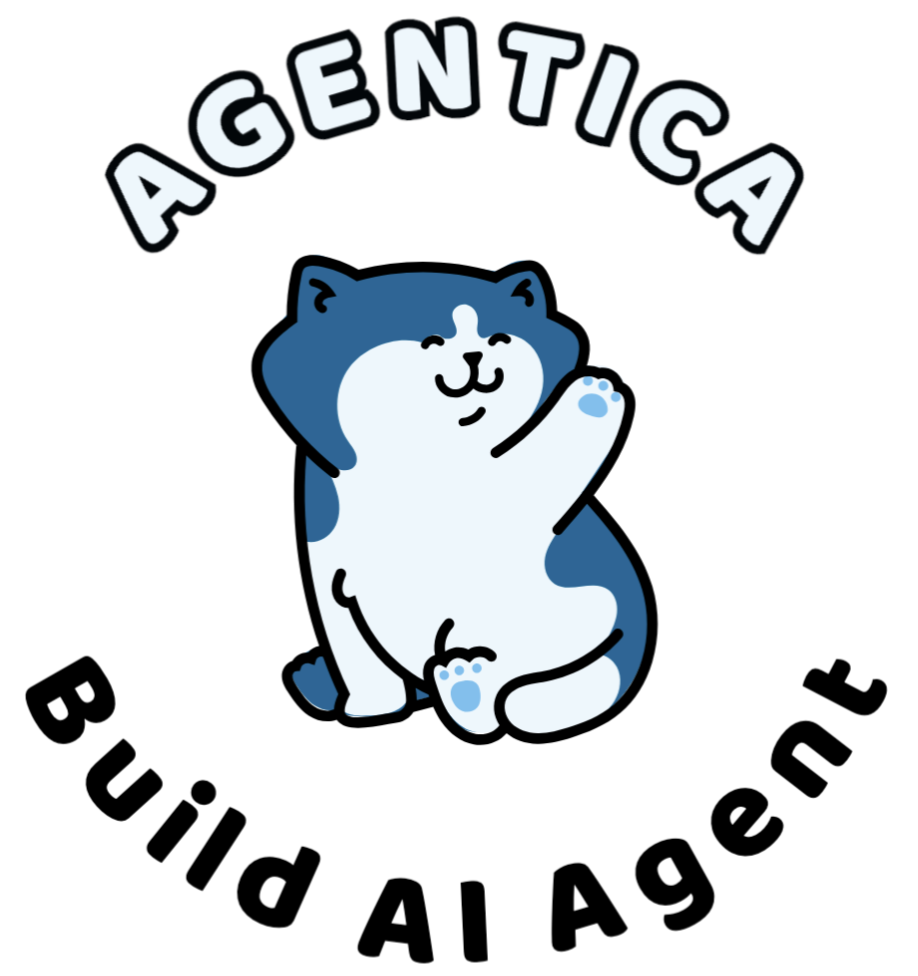

# Agentica 使用文档

**跑在你自己电脑上的全能 AI 工作台。**
桌面端、CLI 终端、本机 Web、手机微信与 Python / TypeScript SDK 共用同一套记忆、技能与模型配置，越用越懂你。

<div align="center">
  
</div>

[](https://badge.fury.io/py/agentica)
[](https://pepy.tech/project/agentica)
[](https://github.com/shibing624/agentica)
[](https://github.com/shibing624/agentica/blob/main/LICENSE)
[](https://github.com/shibing624/agentica)

---

## 你想怎么用 Agentica？

| 你的目标 | 从哪里开始 |
|---|---|
| **在终端里写代码、查问题、跑长任务** | 1. [安装与配置](getting-started/installation.md)（`uv tool install agentica`）<br>2. [CLI 终端指南](getting-started/terminal.md)（`@文件`、`/model`、`/resume`、`/goal`、`/worktree`） |
| **用桌面端，打开即用** | [下载桌面版](https://shibing624.github.io/agentica/desktop/) |
| **用网页** | [Web 与桌面端](advanced/gateway.md)（`uv tool install "agentica[gateway]"` → `agentica-gateway`） |
| **在手机微信里遥控电脑上的会话** | [微信与 IM](advanced/im.md) |
| **在自己的 Python 项目里嵌入 Agent** | 1. [5 分钟上手 (SDK)](getting-started/quickstart.md)（`uv add agentica`）<br>2. [Agent 与 DeepAgent](concepts/agent.md) · [最佳实践配方](guides/best_practices.md) |
| **了解内部架构与设计原因（开发者选读）** | [架构与内部实现](introduction/architecture.md) · [内置工具设计判据](concepts/builtin-tool-bar.md) |

---

## 30 秒体验

```bash
uv tool install agentica
export ZAI_API_KEY="your-api-key"   # 或 OPENAI_API_KEY / DEEPSEEK_API_KEY / ANTHROPIC_API_KEY
agentica
```

嵌进 Python 项目见「开发」里的 [5 分钟上手 (SDK)](getting-started/quickstart.md)。

---

## 文档导航

顶部三个分类会展开。下载安装包在 [下载桌面版](https://shibing624.github.io/agentica/desktop/)。

### 入门

| 文档 | 内容 |
|------|------|
| [Agentica 是什么](introduction/what-is-agentica.md) | 产品形态与核心能力 |
| [安装与配置](getting-started/installation.md) | 安装 CLI / Web，配置模型 API Key |
| [CLI 终端](getting-started/terminal.md) | 命令行参数、`@文件`、斜杠命令 |
| [Web 与桌面端](advanced/gateway.md) | 本地网页、桌面端工作区与审批 |
| [微信与 IM](advanced/im.md) | 微信扫码、手机遥控本机会话 |
| [Schedule 提醒](getting-started/schedule.md) | 在对话或「自动化任务」里创建、修改、运行提醒 |
| [定时任务](guides/cron_scheduler.md) | CLI `/cron` 与独立 daemon |
| [记忆与常驻规则](concepts/memory.md) | 会话历史、`MEMORY.md`、`AGENTS.md` |
| [记忆 MCP](getting-started/memory-mcp.md) | 把外部记忆服务接到工具列表 |

### 开发

| 文档 | 内容 |
|------|------|
| [5 分钟上手 (SDK)](getting-started/quickstart.md) | 同步/异步、流式输出、绑定工具 |
| [Agent 与 DeepAgent](concepts/agent.md) | 轻量 `Agent` 与全功能预设 |
| [工具与自定义工具](concepts/tools.md) | 内置工具、`@tool`、搜索引擎 |
| [MCP](advanced/mcp.md) | stdio / SSE / HTTP |
| [最佳实践](guides/best_practices.md) | 即拷即用的配方 |

### 参考

| 文档 | 内容 |
|------|------|
| [配置文件](guides/config.md) | `~/.agentica/config.yaml` |
| [模型速查](guides/models.md) | 各家模型的配置示例 |
| [Agent API](api/agent.md) | `Agent`、`PromptConfig`、`ToolConfig`、`RunResponse` |
| [架构](introduction/architecture.md) | 执行循环、缓存快照、压缩不变量 |

---

## 社区与支持

- **GitHub Issues** -- [提交 issue](https://github.com/shibing624/agentica/issues)
- **微信交流群** -- 添加微信号 `xuming624`，备注 "llm"

## 许可证

[Apache License 2.0](https://github.com/shibing624/agentica/blob/main/LICENSE)
